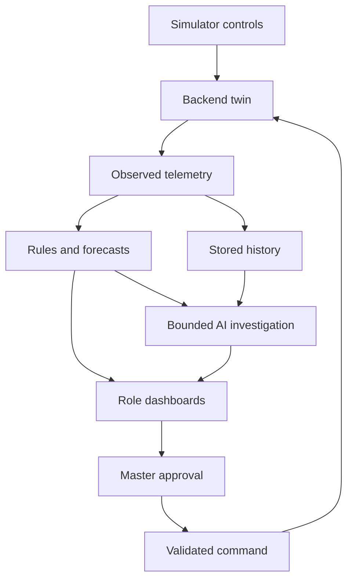

# CLAUDE.md — PS01 Spacecraft Digital Twin

Version: 2.0 | Owner: Param Raj Singh | Binary Hacks 4.0 | Hackathon build specification

## 0. Read this before coding

Build a convincing, working prototype for a **spacecraft already operating in space**. The product is not a launch predictor. This file is self-contained and replaces version 1.1 of the previous project plan.

**NASA/ISRO inspiration means UI/UX only:** mission-control layouts, readable telemetry, useful graphs, clear status and operational workflows. It does not request agency-level security, infrastructure, certification or backup systems.

The priority is a working demonstration:

**Inject a condition → receive shared telemetry → detect a problem → forecast its consequence → compare a supported action → master approves → observe whether recovery actually happens.**

### 0.1 How to execute phases

The user can say `Do Phase 1`, `Do Phases 2 and 3`, `Continue Phase 4`, or `Verify Phase 6`.

1. Read this specification, the requested phase, the ledger and the existing repository.
2. Implement the requested phase and run its relevant checks. Do not return only another plan.
3. Preserve existing user work. Reuse functioning code and dependencies; do not rebuild to match a preferred scaffold.
4. Repair small prerequisites as needed. If a whole prerequisite phase is missing, explain that dependency instead of silently implementing all phases.
5. Update the ledger with actual changes, checks, results, limitations and the next unfinished task. Never invent completion, tests or deployment results.
6. Stop after the requested phase(s). A screenshot alone is not proof of a working backend.
7. Work autonomously on reversible implementation. Ask only for a material missing choice, credential, spending authorization or actual blocker. Follow existing tool permissions and user authorization.
8. Do not run multiple coding agents unless the user asks. Conserve coding allowance; keep patches focused.

Statuses: `NOT_STARTED`, `IN_PROGRESS`, `BLOCKED`, `COMPLETE`, `DEFERRED`. Use `COMPLETE` only when the stated acceptance checks pass. Missing live AI credentials can block that integration without blocking the rest of the app.

### 0.2 Migrating work from the previous plan

Phase numbers have changed. Do not interpret “Phase 4 was complete” from version 1.1 as completion of Phase 4 here. Inspect existing code and map capabilities to the new acceptance checks. Preserve the old work log in repository history or `docs/previous-progress.md` before replacing it. This supplied file records specification status, not the state of the user's local code.

Keep working auth, models, database and UI if already implemented. Do not remove existing useful infrastructure just to simplify the diagram; stop adding deferred infrastructure. Record deliberate stack differences in the ledger.

### 0.3 Priority and boundaries

| Priority | Build |
|---|---|
| Required first | Shared simulator, login roles, mathematics, incidents, one tested forecast/action/recovery flow |
| Required for final demo | Five dashboards, live AI investigation with fallback, historical daily/weekly/monthly views, deployment and essential checks |
| Optional after the core works | Isolation Forest with proper evaluation, extra fault families, advanced action catalogue, sensitivity envelopes |
| Deferred beyond hackathon | Separate report workers, durable distributed queues, multi-instance leadership, automated backup/restore drills, extensive retention machinery, high availability, exhaustive security testing |

Keep basic security: hashed passwords, server-side role checks, secure deployed cookies, protected commands and secrets kept off the client. Keep mathematical correctness, stale-data visibility and command validation. These make the demo function correctly; they are not NASA-level infrastructure.

## 1. Product and scope

One deployed website is used on five laptops:

- Simulator console: change demonstration conditions and run a fictional spacecraft.
- Master console: overall health, all incidents, predictions and approval of supported recovery commands.
- Power console: generation, battery and electrical load.
- Thermal/propulsion console: temperatures, heaters, propellant and pressure.
- Flight systems console: attitude, wheel, communication and computer health.

A single login page routes the authenticated account to its own console. Laptops are clients; closing the simulator browser must not stop the backend simulation.

The user's camera and 2 AM examples explain behaviour; they are not compulsory features. Use a generic optional payload and equipment schedules. An example saying “used 200 volts” must be corrected in UI/data design: voltage is V, power is W and consumed energy is Wh.

### 1.1 Responsibilities

| Component | Responsibility | Must not claim |
|---|---|---|
| Mathematical twin | Expected behaviour, energy/temperature projections, action comparison | Validated real spacecraft prediction |
| Rules | Known limits, trends, model residuals, stale data and mismatched commands | Certainty about every root cause |
| Optional ML | Learn normal combinations and flag unusual patterns | Automatic diagnosis or calibrated failure probability |
| Live AI investigator | Fetch bounded incident evidence/history/forecast and explain supported hypotheses | Independent truth, command authority or numerical calculations without tools |
| Historical analysis | Count recurrence, compare schedules, summarize daily/weekly/monthly evidence | That generated data came from an actual month of operation |
| Human master | Approve permitted simulator actions and inspect outcomes | That approval itself means recovery |

The PS text provided by the user requires an intelligent digital twin, anomaly detection, prediction and explainable recommendations. It does not explicitly mandate ML. Our small ML extension must add demonstrated value rather than a decorative “AI score.”

### 1.2 Model scope

Fully couple power, battery and selected thermal nodes. Use a simple cold-gas pressure model. Attitude, wheel, link and resets may use explicitly labelled deterministic profiles. Showing a reading is not a claim that its future behaviour is physically modelled.

Use the 28-channel baseline in section 6. The earlier informal count of 25 is not a fixed requirement. Implement the core power/thermal subset first, then extend the display and profiles. Do not manufacture unrelated random numbers to fill cards.

### 1.3 Invariants

- All clients observe one authoritative backend run and the same observation sequence.
- Detection, forecasting, ML and AI receive observations and known schedules/commands, never hidden fault selectors, future injected events or perfect simulator truth.
- Simulator-only truth is stored and serialized separately from operational evidence.
- Repeated samples of one problem update one incident. Acknowledgement and resolution are different.
- Missing data is not zero and not healthy. Unsupported forecasts say unavailable.
- Forecasts and actions state assumptions and limitations; no invented accuracy or confidence percentages.
- AI failure must not delay or disable telemetry, deterministic warnings, forecasts or permitted manual recovery.
- No automatic action execution by an LLM. No LLM call for every telemetry tick.
- No promise of zero errors or NASA/ISRO certification.

## 2. Simple implementation architecture

### 2.1 Default stack

Reuse an existing working equivalent stack if present. For a new repository:

| Layer | Choice |
|---|---|
| Web | Next.js static export, TypeScript, Tailwind, Recharts; React context or an existing small store |
| API and models | FastAPI, Python 3.11+, Pydantic, NumPy |
| Storage | PostgreSQL, SQLAlchemy and Alembic |
| Live updates | Server-Sent Events (SSE); REST for commands |
| AI | One provider adapter using a server-side API key and environment-configured model |
| Optional ML | scikit-learn Isolation Forest; local inference inside backend |
| Deployment | One persistent host; Docker Compose for Caddy, API and PostgreSQL; Caddy serves exported frontend |
| Checks | pytest, frontend type/build checks, a focused Playwright flow |

Use current official docs when selecting compatible versions and implementing SDK calls. Commit dependency locks. Do not switch package managers midway through the hackathon.

One API process owns the simulation, incident engine and bounded background analysis task. **No separate report-worker service or distributed job broker in this version.** Run one Uvicorn worker, with no production autoreload or multiple replicas. Stop the old instance before starting a replacement. Never use a request-only/serverless runtime for the always-running simulation loop without redesigning it explicitly.

### 2.2 Data flow



An optional ML score joins the incident evidence after Phase 10; it does not replace the mathematical path.

### 2.3 Live loop

1. At approximately 1 Hz, apply accepted commands at the tick boundary and advance simulated state with explicit `dt_s`.
2. Generate observed telemetry with seeded noise and quality markers.
3. Evaluate quality, rules and incident state; schedule bounded forecast work when due.
4. Store the observed frame, relevant incident changes and command outcomes in a short transaction.
5. Publish committed state to SSE clients. Do not show a database write failure as successfully recorded data.
6. On new/escalated incidents, enqueue a bounded AI investigation independently of this loop.

Use one in-process lock for run changes/commands. Do not hold it during network calls to AI. Compute expensive forecasts from immutable copies off the event loop. Keep only the most recent pending forecast; never accumulate unbounded per-second tasks. Before publishing a completed forecast or analysis, confirm its run/source revision still matches; keep outdated results in history and label them stale rather than attaching them to a reset run.

On database failure, pause the demo and display an explicit storage error. Fixing distributed failover is out of scope. A simple restart resumes the application with its last run marked paused; the simulator user starts or resets it explicitly. Store a private snapshot for this purpose; it is not exposed to investigators.

On connection/reconnection, register the subscriber and capture a current permitted snapshot/incident list under the same short in-process lock; send that snapshot first, then buffered newer events. This prevents an incident being lost between a separate snapshot fetch and subscription. Discard older frames by run/sequence. Reset clears chart buffers and starts a new run ID while retaining previous database history. Full replay of every missed stream event is deferred.

## 3. Accounts and permissions

| Account role | Route | Read | Write |
|---|---|---|---|
| `SIMULATOR` | `/simulator/` | Current simulator state, hidden injections | Start/pause/reset, bounded scenario controls |
| `MASTER` | `/master/` | All operational telemetry, incidents, analysis | Acknowledge, request comparison, approve allowed recovery |
| `POWER` | `/power/` | Power details and relevant dependencies | Acknowledge assigned incidents, request investigation/comparison |
| `THERMAL_PROPULSION` | `/thermal/` | Thermal/propulsion and relevant dependencies | Same, within assigned scope |
| `FLIGHT_SYSTEMS` | `/flight/` | Flight systems and relevant dependencies | Same, within assigned scope |

`/login/` is shared. The server returns role from the authenticated account; the browser does not assign its own role. Use fixed routes compatible with static export. A shared `/history/` view is scoped by the account.

- Provision five users with a script and unique passwords; no public signup or role selector.
- Use an established password hashing library and server-side sessions. Cookies are HttpOnly, Secure in deployed HTTPS, SameSite=Lax.
- Apply role authorization to all API endpoints, including SSE and history. Unauthenticated means 401; unauthorized means 403.
- Protect authenticated mutations against cross-site requests using CSRF tokens and allowed-origin validation; protect login origin too.
- Keep API keys, passwords, session tokens and full prompts containing private data out of frontend bundles and ordinary logs.
- Basic login throttling is enough for this prototype. Enterprise identity, penetration-test suites and elaborate account management are deferred.
- Simulator injection is not the same endpoint as a master's recovery action. Operational accounts never retrieve hidden simulator fields.

## 4. Repository and configuration

Proposed layout; preserve equivalent existing structure:

```text
CLAUDE.md
README.md
.env.example
compose.yaml
Caddyfile
frontend/
  app/                 # login and five role routes, history
  components/          # telemetry, charts, incidents, predictions
  lib/                 # typed API, SSE and auth helpers
backend/
  app/
    main.py
    auth.py
    api/
    simulation/        # truth, observations, deterministic scenarios
    monitoring/        # quality, rules, incidents
    forecasts/         # observed-state estimates and what-if actions
    analysis/          # statistics, AI tools, provider, optional ML
    storage/           # models and queries
    config/
  tests/
  migrations/
  pyproject.toml
scripts/
  seed_users.py
  generate_history.py
  train_anomaly_model.py  # only when optional ML is implemented
docs/
  demo.md
  validation.md
  decisions.md
```

Put vehicle, telemetry, rule and allowed-action definitions in validated YAML or typed configuration. Units, limits, assumptions and model versions belong in configuration rather than scattered UI code. A forecasting function and the live twin share model functions but never share a mutable truth object.

Environment template names:

```text
DATABASE_URL=
APP_ORIGIN=
SESSION_SECRET=
COOKIE_SECURE=true
SIM_TICK_SECONDS=1
FORECAST_INTERVAL_SECONDS=5
AI_ENABLED=false
LLM_PROVIDER=
LLM_MODEL=
LLM_API_KEY=
LLM_TIMEOUT_SECONDS=20
LLM_DAILY_CALL_LIMIT=30
LLM_MAX_OUTPUT_TOKENS=1200
AI_INCIDENT_COOLDOWN_SECONDS=120
ANOMALY_MODEL_PATH=
```

Defaults are configurable prototype choices. Subscriptions to chat products are not assumed to provide API credentials or credits. AI-disabled mode must work without a key. Use the user's available authorized API provider; never extract a chat session token.

README must contain tested installation, development, migration, user provisioning, fixture generation, test, build, start and stop commands. Prefer standard package scripts/direct commands; do not build a cross-platform orchestration framework. Document Windows/WSL requirements honestly if Docker is used. Stopping containers must not delete stored data.

## 5. NASA/ISRO-inspired UI/UX

This is a design direction, not a claim of copying an official control-room interface. Use no official seals or branding suggesting endorsement.

- Deep navy/charcoal background, clear white/slate text, restrained cyan accent; amber warning, red critical, grey unavailable. Pair colour with text/icon.
- Readable tabular numbers, explicit units, consistent spacing and stable positions. No flashing cards, decorative starfields, heavy animation or unnecessary 3D.
- Persistent header: run ID, LIVE/SYNTHETIC/REPLAY source, simulated clock, connection/freshness, illumination and operating mode.
- Overview first, detailed evidence on selection. Do not put all 28 plots on every specialist screen.
- Charts preserve physical units and show current/expected values, configured limits, forecast as dashed line and schedule markers. Never combine V and °C on an unexplained shared axis.
- Optional normalized comparison displays must keep the actual value/unit available. A value of 50 is not automatically 50% health.
- Target 1366×768 laptops and 1920×1080 master screen; allow scrolling for secondary detail. Maintain keyboard focus and readable contrast.

| Screen | Main content |
|---|---|
| Simulator | Run/scenario controls, actual bounded settings, optional hidden truth for presenter only, pause/reset |
| Master | Subsystem status, compact 2D spacecraft diagram, key values, shared incident list, baseline/action forecast, approval and outcome |
| Power | Generation, demand, battery SOC/current/temperature; eclipse markers; energy reserve forecast |
| Thermal/propulsion | Node temperatures/heater state, pressure/mass/valve; distinguish modelled forecast from profile-only readings |
| Flight | Pointing/rates/wheel, contact and link quality, resets; show stale evidence explicitly |
| Shared investigation/history | Evidence, hypotheses, missing evidence, supported actions, daily/weekly/monthly summaries and source dates |

An incident opens immediately with deterministic evidence text. AI status then reads queued/running/completed/unavailable and updates separately. Existing alerts and action controls remain usable while AI is working.

## 6. Telemetry contract

### 6.1 Channel dictionary

Define exactly these initial channel IDs unless the user changes scope. JSON uses stable IDs, not UI labels. Groups: P = power; T = thermal/propulsion; F = flight systems. A second group indicates cross-system visibility.

| # | ID | Unit | Group | Source and scope |
|---|---|---|---|---|
| 1 | `solar_voltage` | V | P | Simulated panel sensor; electrical model |
| 2 | `solar_current` | A | P | Simulated panel sensor; electrical model |
| 3 | `bus_voltage` | V | P | Electrical model with regulated supply/shortage behaviour |
| 4 | `load_power` | W | P | Metered or derived total demand; show provenance |
| 5 | `battery_soc` | % | P | Estimated energy state, not perfect true-state access |
| 6 | `battery_voltage` | V | P | Modelled battery terminal voltage |
| 7 | `battery_current` | A | P | Positive discharge, negative charge |
| 8 | `battery_temperature` | °C | P,T | Thermal observation |
| 9 | `cell_voltage_spread` | V | P | Simplified imbalance profile; rule-only initially |
| 10 | `panel_temperature` | °C | T,P | Simplified thermal observation |
| 11 | `computer_temperature` | °C | T,F | Simplified thermal observation |
| 12 | `payload_temperature` | °C | T | Simplified thermal observation |
| 13 | `tank_temperature` | °C | T | Thermal observation used in gas consistency |
| 14 | `heater_power` | W | T,P | Observed heater activity, compared with command |
| 15 | `propellant_mass` | kg | T | Estimated cold-gas quantity |
| 16 | `tank_pressure` | bar absolute | T | Gas-store pressure sensor |
| 17 | `thruster_valve_open` | boolean | T | Observed valve status, separate from command |
| 18 | `thruster_temperature` | °C | T | Toy cold-gas thruster thermal observation |
| 19 | `pointing_error` | degree | F,P | Simplified deviation from desired orientation |
| 20 | `roll_rate` | degree/s | F | Simplified angular rate |
| 21 | `pitch_rate` | degree/s | F | Simplified angular rate |
| 22 | `yaw_rate` | degree/s | F | Simplified angular rate |
| 23 | `wheel_speed` | RPM | F | One selected wheel, not a full wheel assembly |
| 24 | `wheel_current` | A | F,P | Selected wheel current; simple consistency |
| 25 | `link_snr` | dB | F | Link observation during contact |
| 26 | `packet_error_rate` | % | F | Rolling ratio with explicit window and denominator |
| 27 | `computer_reset_count` | count | F | Cumulative within run, with separate reset events |
| 28 | `telemetry_age` | s | F,master | Ground-derived time since last valid received frame |

### 6.2 Channel metadata

Each entry in `telemetry.yaml` must include: ID, label, unit, groups, type, provenance, physical-validity bounds, display bounds, update cadence, expected-value method, mode-specific rule references and prediction coverage. A missing warning bound can be `null`; no invented threshold is required for every value.

- Physical-validity bounds reject impossible encodings; operating limits describe a configured vehicle; display ranges only control chart appearance. Keep them separate.
- Negative current is valid while charging. Negative Celsius is valid. Absolute gas temperature must be above zero kelvin.
- SOC and packet-error estimates outside 0–100% are invalid rather than silently corrected in displayed evidence.
- Boolean and count channels are not continuous floating-point gauges.
- Quality enum: `VALID`, `MISSING`, `STALE`, `INVALID`, `SUSPECT`. Store a reason and source timestamp. Keep last valid value separate from current quality.
- Use `null` for unavailable values. Never send NaN/Infinity in JSON and never turn missing values into zero.
- Preserve raw observations for diagnosis. Filtered values must be separately named and traceable.

### 6.3 Context and clocks

Context contains vehicle/config version, run/source ID, mode, illumination, eclipse schedule, expected contact, equipment schedule, acknowledged commands and model/rule version. It is not part of the channel-count target.

Modes initially: `NOMINAL`, `PAYLOAD_ACTIVE`, `SAFE`, `MANEUVER`. Illumination `SUNLIGHT`/`ECLIPSE` and contact expected/not expected are separate dimensions, not substitutes for mode.

Persist:

- `sim_time_s`: elapsed spacecraft simulated seconds.
- `sim_epoch_utc`: date-time mapping for scheduled tasks and synthetic histories.
- `received_at_utc`: actual backend receipt time for live observations.
- `tick_seq`: simulator advancement counter; restricted truth checkpoint detail.
- `frame_seq`: received observation sequence; does not advance just because an old reading is redisplayed.
- `event_seq`: monotonically increasing stream sequence within the current server session; reconnect always fetches a fresh snapshot. Durable stream replay is deferred.
- `control_revision`: increments on relevant configuration, mode, schedule or command changes; not on every telemetry sample.

Compute live telemetry age using a monotonic elapsed receipt clock. In accelerated historical runs, use simulated-time receipt gaps. Label historical versus live units of time; never mix the clocks in one duration calculation. Unexpected stale coverage targets: warning after 3 seconds, critical data-unavailability after 10 seconds during expected contact. These are demonstration settings.

## 7. Mathematical models

### 7.1 Configuration discipline

`spacecraft.yaml`, `rules.yaml` and `actions.yaml` are versioned inputs with schema validation. Include units and provenance for every constant. Accept reasonable fixture defaults without asking the user to invent spacecraft physics. Validate them; record any engineering changes in `docs/decisions.md`.

The following numerical baseline is **an illustrative test vehicle**, not a real spacecraft specification. Use it to make implementation and independent tests reproducible.

| Parameter | Initial fixture value |
|---|---:|
| Battery reference capacity | 1,000 Wh |
| Initial battery SOC | 70% |
| Regulated bus target | 28 V |
| Maximum available sunlit solar power | 300 W |
| Essential nominal equipment demand | 100 W |
| Optional payload nominal demand | 80 W |
| Heater rated nominal power | 30 W |
| Charge/discharge efficiency | 0.95 / 0.95 |
| Charge power limit / discharge power limit | 200 W / 500 W |
| Battery terminal voltage toy range | 24–29 V, interpolated with energy fraction before load effect |
| Battery series resistance | 0.05 ohm, toy value |
| SOC reserve warning / critical | 20% / 10% |
| Fixed observation interval | 1 simulated second |
| Forecast horizon | 1,800 simulated seconds |
| Forecast output grid | At most 181 time points, plus exact detected crossing events |
| Example environment cycle | 60 min sunlight, then 30 min eclipse, repeated as a configured schedule |

Do not claim the example environment cycle is an orbital calculation. Fault demos can begin close to a scheduled eclipse or reserve boundary with visibly labelled initial conditions; do not falsify timestamps to force a dramatic result.

### 7.2 Electrical and battery model

Choose one explicit power boundary. In V1, solar and total demand below are bus-side values; battery conversion losses are represented by efficiencies. Panel voltage/current reflect dispatched output and curtailment, while `available_solar_power` is separate derived context.

```python
available_solar_w = solar_rated_w * illumination_factor * generation_factor
# generation_factor is hidden in the simulator; the observer estimates it from observations.
requested_load_w = essential_w + payload_w + heater_w + wheel_extra_w + valve_w + fault_load_w
surplus_w = available_solar_w - requested_load_w
charge_bus_w = min(max(surplus_w, 0), charge_limit_w,
                   (capacity_wh - energy_wh) * 3600 / (eta_charge * dt_s))
discharge_bus_w = min(max(-surplus_w, 0), discharge_limit_w,
                      energy_wh * eta_discharge * 3600 / dt_s)
delta_wh = (eta_charge * charge_bus_w - discharge_bus_w / eta_discharge) * dt_s / 3600
next_energy_wh = min(capacity_wh, max(0, energy_wh + delta_wh))
unmet_load_w = max(0, requested_load_w - available_solar_w - discharge_bus_w)
curtailed_w = max(0, available_solar_w - requested_load_w - charge_bus_w)
solar_dispatched_w = available_solar_w - curtailed_w
soc_percent = 100 * next_energy_wh / capacity_wh
```

Clamp tiny rounding artifacts only; do not hide a large conservation error. Use available energy/space constraints before clamping. At empty battery, record unmet demand and apply declared load shedding; do not continue powering all equipment with SOC fixed at zero.

Battery current is calculated from battery-side power and terminal voltage, with positive discharge. Choose a physically consistent terminal-voltage solution using the toy open-circuit voltage, resistance and power; reject an impossible solution and limit delivered power. A regulated bus can stay near 28 V while battery terminal voltage varies. Do not equate the two without a stated converter model.

`load_power` represents requested metered demand; additionally expose derived served/unmet power in engineering detail. Include heater demand and wheel increments exactly once. Essential 100 W includes the nominal wheel allowance; only extra wheel demand is added.

At full battery, curtailed panel current is expected. Generation-shortfall rules must not flag low dispatched power when there is no demand or charging headroom.

Analytic reference: battery energy drops by approximately 52.6316 Wh when supplying a 100 W bus load for 1,800 seconds at 0.95 discharge efficiency with no solar power.

### 7.3 Thermal model

Use an explicit lumped-node approximation:

```python
heat_out_w = conductance_w_per_k * (temperature_c - effective_boundary_c)
next_temperature_c = temperature_c + (heat_in_w - heat_out_w) * dt_s / heat_capacity_j_per_k
```

This effective linear boundary represents a toy heat-rejection model over a limited range, not air convection in vacuum or a full radiation model. Use Celsius differences only; radiation/ideal-gas formulas require kelvin.

Starter node fixture values, adjustable after independent validation:

| Node | Heat capacity J/K | Conductance W/K | Initial °C | Heat input |
|---|---:|---:|---:|---|
| Battery | 1,800 | 1.2 | 20 | Calculated electrical losses plus configured heater allocation |
| Panel | 3,000 | 1.5 | 30 | 60 W when sunlit, 0 W when eclipsed |
| Computer | 1,000 | 1.0 | 25 | 15 W nominal; off if essential power unavailable |
| Payload | 1,200 | 1.6 | 25 | 35% of served payload electrical power |
| Tank | 2,500 | 0.4 | 15 | 2 W nominal effective input |
| Cold-gas thruster | 500 | 0.8 | 15 | Configured valve/actuator heat, not combustion heat |

Effective boundary starts at 10°C in sunlight and -5°C in eclipse. Heater thermostat targets the battery: on below 8°C, off above 12°C; state holds between thresholds. Heater power must be part of total electrical demand. Simulated stuck-on actuator behaviour remains independent of the requested state.

Illustrative battery thermal warning: below 0°C or above 40°C for 10 seconds; critical above 45°C for 2 seconds. Configure separate node limits rather than copying battery limits to panels or thrusters. Any additional limits introduced by the implementer must be documented as fixture assumptions and tested.

Test equilibrium and compare explicit integration against the analytic first-order step response. Select internal time steps small relative to the smallest thermal time constant. Negative absolute temperature is invalid. Do not produce indefinite temperature rises with no corresponding energy input.

### 7.4 Propellant and pressure

Use a simple cold-gas model to make mass/pressure relationships implementable. Fixture: nitrogen-like specific gas constant `296.8 J/(kg*K)`, gas mass `0.20 kg`, tank volume `0.010 m³`, initial temperature `288.15 K`. Ideal pressure is approximately `17.1046 bar absolute`.

```python
pressure_pa = gas_mass_kg * specific_gas_constant * temperature_k / volume_m3
consumed_kg = min(gas_mass_kg, commanded_flow_kg_per_s * dt_s)
```

Example nominal valve flow `0.0001 kg/s` when open. Clamp consumption to available mass. The V1 thermal/flow model is simplified and does not certify real blowdown behaviour. A pressure decrease caused by cooling is not by itself a leak. Do not assert independently confirmed mass loss when the displayed mass estimate was itself derived from pressure.

No propulsion recovery command is enabled unless its physical and operational prerequisites are modelled and tested. Rule-only warnings are acceptable for this subsystem.

### 7.5 Flight systems and communication

- Define deterministic seeded normal profiles for rates, wheel speed/current and pointing error. Mark these as simplified profiles, not a validated attitude-control model.
- If pointing affects solar generation, document that coupling and use the same observation-based relationship in expected generation. Include scheduled pointing changes as context.
- Do not claim high-confidence root cause from wheel current alone.
- Calculate packet error rate from attempted/failed packet counts over a 60-second window; return unavailable when the denominator is zero.
- Expected contact gaps do not produce a false “radio failed” incident, but telemetry still becomes stale.
- Unexpected resets use timestamped events as well as the cumulative counter. A new run resets the counter without implying a physical reset event.

### 7.6 Estimation and measurement errors

Use seeded, documented small sensor noise and optional sensor bias/dropout. Bound and validate noise separately from the true model. State estimation uses only received data, known commands and nominal parameters. Initialize SOC from the reported estimate, then reconcile with energy/current observations; never use hidden future truth.

Keep raw, filtered and expected values separate. Filter windows and their resulting detection delay are configured. Mode transitions reset or adapt baselines explicitly. Do not train on test scenarios or use fault-injection timestamps in detection logic.

## 8. Rules and incidents

### 8.1 Rule pipeline

1. Parse types and units; reject malformed data while preserving error evidence.
2. Evaluate freshness and channel quality.
3. Determine applicable operating context and scheduled transitions.
4. Evaluate configured limits, persistence, trends and observed-minus-expected residuals.
5. Combine related evidence only through explicit dependency rules.
6. Open or update incidents; assign responsible groups.
7. Request a supported forecast or mark it unavailable.
8. Reevaluate after an action; resolve only after healthy dwell.

Rule catalogue: implement the first six for the core demo; the remaining four are later enhancements. Display unsupported detection coverage honestly.

| Rule ID | Evidence | Output |
|---|---|---|
| `DATA_STALE` | No valid frame during expected contact | Missing-data incident; preserve last-known values |
| `GENERATION_SHORTFALL` | Sunlight, available demand/headroom, panel output below expected, unexpected discharge | Suspected generation deficit; not a guaranteed panel fault |
| `ENERGY_RESERVE` | Forecast or observation crosses configured reserve | Warning/critical battery reserve consequence |
| `THERMAL_LIMIT` | Valid temperature persists beyond node limits | Node thermal incident with trend |
| `ACTUATOR_MISMATCH` | Known command differs from observed state/power beyond response allowance | Suspected actuator/command issue |
| `SUPPLY_SHORTAGE` | Bus deviation or unmet demand with corroborating current/load | Power shortage; fast interlock runs separately in simulator |
| `PRESSURE_INCONSISTENCY` | Pressure/temperature relation differs from model and known usage | Propulsion consistency investigation |
| `FLIGHT_PROFILE_DEVIATION` | Rates/pointing/wheel values depart from configured mode profile | Rule-based flight-system anomaly |
| `RESET_RECURRENCE` | Multiple distinct reset events in configured window | Repeated computer reset investigation |
| `SENSOR_INCONSISTENCY` | Measurement behaviour conflicts with other available evidence/model | Suspected sensor issue, or insufficient evidence |

Sample generation rule: median shortfall over 30 seconds exceeds 20% of eligible expected dispatched generation and battery is unexpectedly discharging. Ignore undefined ratios near zero. These are starting test thresholds, not universal flight limits.

### 8.2 Incident contract

Required fields: UUID, run ID, rule ID/version, family, subsystem/affected groups, severity, lifecycle, first_seen, last_seen, source frames, observed evidence, suspected causes, missing evidence, forecast reference, acknowledgement, resolution evidence and timeline.

- Lifecycle: `PENDING` -> `OPEN` -> `RECOVERING` -> `RESOLVED`.
- Acknowledgement fields are orthogonal to lifecycle.
- Severity: `INFO`, `WARNING`, `CRITICAL`. `UNKNOWN` is coverage/diagnosis, not automatically critical.
- Suppress duplicate openings by run + rule family + affected entity while active. A recurrence after resolution gets a new incident linked to previous ones.
- Suggested healthy dwell: 10 seconds; customise per rule. Missing data must not satisfy healthy dwell.
- Hysteresis: for the toy high-temperature warning at 40°C, recovery begins below 38°C; critical downgrade has its own configured recovery boundary.
- Parent/child incident linkage is rule-based, with visible supporting reasons. Do not collapse unrelated symptoms into one story.

## 9. Forecasts and recovery

### 9.1 Forecast engine

Update observed state every second. Initially recalculate the forecast every 5 seconds, and immediately on a new incident or command. Keep at most one computation running and one replaceable pending request. Run it outside the request event loop. Publish its source frame and age. A 1 Hz telemetry stream does not require 1 Hz LLM calls or a new expensive forecast every second.

Baseline horizon: 30 simulated minutes. Integrate through known schedule discontinuities exactly or split at event boundaries. Internal numerical step is selected by stability/accuracy tests; output is decimated for display without hiding extrema or crossings.

Each result stores source frame, model/config versions, generation time, horizon, schedule assumptions, projected energy/temperature paths, configured-limit crossing times and coverage reasons.

- Unknown future commands/fault injections are not known schedules.
- Avoid a fixed “failure at 18 minutes” label. Show “projected reserve crossing in approximately X under these assumptions.”
- Show assumptions and model limitations in the core demo. A sensitivity envelope is optional after the demo works; it must not be labelled a calibrated probability or confidence interval.
- No fresh evidence or an unsupported subsystem means limited/unavailable prediction.
- If no crossing occurs within the horizon, say that; do not call the spacecraft indefinitely safe.

### 9.2 Allowed action catalogue

Actions are predefined code with modelled consequences, never executable text generated by AI. Catalogue: the core demo needs `REDUCE_PAYLOAD_POWER` and `ISOLATE_OPTIONAL_BRANCH`. Implement the other actions only when a chosen demonstration requires them; disabled actions must not appear as available fixes.

| Action ID | Operation | Prerequisites and trade-off |
|---|---|---|
| `REDUCE_PAYLOAD_POWER` | Select an allowed payload duty level, initially 0%, 50%, 100% | Payload is nonessential; reducing it delays configured mission work |
| `POSTPONE_PAYLOAD_TASK` | Shift a nonessential scheduled task to a selected allowed slot | Task exists; slot inside configured schedule; record lost/delayed operation |
| `SET_HEATER_AUTO` | Restore commanded thermostat operation | Actuator is controllable; if it ignores commands, response may fail |
| `ISOLATE_OPTIONAL_BRANCH` | Open an independently modelled isolator on an optional branch | Isolation hardware exists in toy configuration; cannot isolate essential power |
| `ENTER_SAFE_MODE` | Apply a defined essential-load and heater policy | Fully defined in configuration; preserve essential radio/computer and temperature constraints |

Enable an action only after its implementation and tests exist. Rule-only subsystem incidents can recommend inspection and explicitly state no tested recovery is available.

### 9.3 Evaluation and execution

Compare the no-action baseline with one relevant implemented alternative initially; expand to at most three alternatives later. Compare all alternatives from the same observed starting state, with the same external schedule. Do not give one option privileged knowledge of the injected fault.

Hard constraints: preserve essential supply, avoid configured thermal violations and respect actuator limits. Rank feasible options lexicographically: avoid critical crossings, preserve minimum reserve, then minimise mission disruption. Explain each trade-off; do not invent a universal percentage score.

A proposal includes ID, action/arguments, evidence frame, input validity bounds, control_revision, expiry, outcome paths and rejection reasons. Suggested TTL 30 seconds; configurable. Changes of ordinary telemetry frame do not alone invalidate it. Changes to relevant controls or observations outside validity bounds require reevaluation.

Execution uses server authorization, CSRF, idempotency and fresh prerequisite checks at both acceptance and application. Return `ACCEPTED`, then separately `APPLIED`, `REJECTED` or `FAILED`. A command may be applied yet fail to improve health; report that outcome after observation. Keep duplicate execution impossible.

## 10. Live AI investigator and historical analysis

### 10.1 Event-driven investigation

This is a required improvement over version 1.1. AI is no longer limited to periodic reports.

Trigger on a newly opened incident, a material severity escalation, failed recovery, or an explicit user request. Do not trigger on each sample or every update of the same warning. Deduplicate by incident plus evidence revision, use a default 120-second per-incident cooldown, and prioritize critical/new incidents. A single continuing issue should not exhaust the API budget.

Use one bounded in-process analysis queue, one concurrent AI job and a configurable daily call limit. Limit pending jobs to 10, coalesce superseded requests, and show deferred status if full. An analysis job interrupted by a restart may be retried manually; durable job leases and separate workers are not a hackathon requirement.

### 10.2 Small agent with restricted tools

Build a constrained investigation workflow, not an unrestricted chatbot. The investigator can choose from these read-only tools:

| Tool | Returns |
|---|---|
| `get_incident_evidence(incident_id)` | Observations, quality, rule evidence and timestamps |
| `get_recent_telemetry(incident_id, channels, window_seconds)` | At most 5 minutes, downsampled to at most 60 points per channel |
| `find_similar_incidents(incident_id, window_days)` | At most 10 relevant historical incidents and outcomes |
| `get_forecast_comparison(incident_id)` | Existing deterministic baseline and supported action results; unavailable if not computed |

Every tool enforces the requesting account's access and the incident's dataset. IDs/window sizes/channels are schema-validated. Tools never expose hidden injection labels, arbitrary SQL, arbitrary filesystem access or action execution.

Bound the loop to at most two model responses and four tool calls per investigation. Reserve budget for the complete job before starting. First response may request tools; the second must produce the final structured explanation. Supply core incident facts initially. Use provider-native tool calling when supported and validate every result. A provider without tool support may use a clearly labelled fixed evidence workflow; do not claim autonomous tool selection in that mode.

The UI should reveal the useful evidence trail: “checked recent power trend”, “found related incidents”, “compared available forecasts”. It should not display private reasoning or invented internal thoughts.

### 10.3 Output contract and fallback

Server supplies canonical IDs, counts, numbers and timestamps. The model returns explanatory fields:

```json
{
  "summary": "Short explanation grounded in observations",
  "observations": [{"text": "Supported observation", "evidence_ids": ["frame:123"]}],
  "hypotheses": [{"text": "Possible cause, not established fact", "evidence_ids": ["incident:abc"], "missing_evidence": ["Useful further check"]}],
  "recommended_action_ids": ["REDUCE_PAYLOAD_POWER"],
  "next_checks": ["Observe whether load falls after the command"]
}
```

Wrap with server-owned `analysis_id`, `incident_id`, `run_id`, evidence revision, generation time, status and `generation_mode` (`LLM`, `TEMPLATE`, `REPLAY`). Check schema, evidence IDs and allowed action IDs. Reject unsupported references. Structured numerical predictions must come from the forecast object, not AI prose. Prefer rendering canonical numbers separately from model text.

Treat stored text as untrusted data, not instructions. No generated executable commands. Present uncertain causes as hypotheses. A plausible explanation is not verification of root cause.

On timeout, malformed output, invalid citations, no key or exhausted budget, publish a deterministic template based on incident evidence and existing forecasts. Label it `TEMPLATE`. Allow at most one transient-error retry within the job budget (at most three provider attempts total, including the two-response tool workflow); never block the live loop. Test both a real authorized provider call and the fallback when available. Mock success does not verify a live integration.

### 10.4 Historical statistics and reviews

Keep the user's daily, weekly and monthly investigation idea. Python/SQL computes facts; AI interprets them.

- Count distinct incidents, their duration/severity, source coverage and failed/successful actions.
- Compare commanded schedules with measured equipment behaviour: command missing, rejected, accepted but ineffective, or outcome unknown because data is absent.
- Compare equivalent operating modes; normalize by relevant operating hours when useful.
- Distinguish recurring incidents from one unresolved incident sampled many times.
- Daily means a completed UTC day; weekly is a selected seven-day window; monthly is a selected completed calendar month. Label partial/custom windows and their coverage.
- Provide “Generate review” and saved cached results. A lightweight in-process scheduler may create completed-period reports while the demo host is running; on-demand generation is the reliable demo path. Do not pretend missed periods were analyzed during downtime.
- Live incidents use stored history immediately; periodic reviews investigate slower patterns.

### 10.5 Historical demo data

Provide a labelled synthetic dataset covering one complete month, with a configurable recurring equipment issue and separate clean periods. It is demonstration evidence, not real spacecraft data.

Generate minute summaries and exact incident/command events offline using deterministic schedules and model/rule functions. Use finer numerical steps internally where needed; do not integrate an unstable thermal model with an arbitrary one-minute step. Preserve short 1 Hz excerpts around selected incidents. Avoid storing 2.6 million raw frames or running expensive 30-minute forecasts at every historical second.

Generate once, cache by seed/config version, and measure generation time. Store synthetic runs separately from live runs. Training, demonstration and evaluation seeds must be distinct if ML is added. Do not hard-code an AI answer instead of deriving recurrence counts from stored events.

## 11. Optional Isolation Forest extension

Implement only after the required demo and deployment checks work. This is Phase 10, not a prerequisite for the core demo.

### 11.1 Purpose and features

Train on labelled-as-normal simulated operations spanning sunlight, eclipse, scheduled payload use and transitions. An unusual reading is not automatically a failure. The model produces an anomaly score, not a failure probability or root-cause diagnosis.

Start with a small coherent feature set: observed-minus-expected generation, load residual, SOC change residual, battery temperature slope, heater command/state discrepancy, and known illumination/mode context. Use short rolling windows computed only from current/past observations. Avoid blindly feeding all 28 unrelated channels into one model. Exclude hidden simulator labels, future values and fault-injection times.

Use a reproducible feature pipeline and consistent units; if scaling is used, fit it only on training data. The mathematical model supplies expected values using known context. A mode-conditioned approach or properly validated context features should prevent scheduled eclipse from being treated as a fault.

### 11.2 Training and evaluation

1. Split by whole runs/seeds, not randomly shuffled adjacent seconds.
2. Train on normal runs; tune threshold on separate validation runs with clean and fault periods.
3. Test on held-out normal transitions and faults with different onset/severity/noise.
4. Report false alarms per normal operating hour, detected fault events, misses and detection delay beside the existing rules.
5. Only enable the model in the demo if it shows useful additional detection without distracting false alarms; otherwise leave it disabled and record why.

Persist the fitted model, feature definitions, training metadata and package versions. Load once at backend startup; local inference does not require per-reading external API calls. Never load untrusted serialized model artifacts.

Require a configured persistence window, e.g. 5 of the last 8 valid scores beyond threshold, before opening an ML anomaly incident. This is a tunable demo setting. Missing data yields unavailable scoring, not a fabricated zero score. Group duplicate rule/ML evidence without hiding provenance.

A new `ML_PATTERN_ANOMALY` incident follows the same evidence, AI and human-approval workflow. If no supported mathematical forecast applies, say so. Do not invent a fix just because an anomaly score is high.

## 12. Database and API contract

### 12.1 Minimal schema

Use UUIDs for domain records, UTC timestamps and explicit run/source IDs.

| Table | Essential fields |
|---|---|
| `users` | username, password hash, role, active |
| `sessions` | hashed token, user, expiry; never plaintext token logs |
| `runs` | source, seed, config/model version, epoch, status, control revision, private checkpoint |
| `telemetry_frames` | run, frame sequence, simulated time, receipt time, values/quality/context JSON |
| `incidents` | rule/family/entity, affected groups, severity, lifecycle, first/last seen, evidence, acknowledgement |
| `incident_events` | incident, timestamp, state/severity/action changes and evidence references |
| `commands` | run, actor, idempotency key, proposal/action, status, application time, observed outcome |
| `forecasts` | source frame/model, assumptions, baseline/action paths, crossing estimates, generated time |
| `analyses` | incident or historical window, evidence revision, mode/status, structured result and usage metadata |
| `history_buckets` | source run, minute timestamp, aggregates, quality/sample counts |

Indexes: `(run_id, frame_seq)` unique, `(run_id, sim_time_s)`, active incidents by run/entity, command idempotency uniqueness, analysis cache key. Private checkpoints are only queried by simulator code, not monitoring serializers or AI tools.

Persist live telemetry at 1 Hz during demos. Use minute summaries for generated month history. Automated retention/partitioning is deferred; document actual disk usage and keep fixture generation bounded. A manually requested cleanup may delete a selected demo dataset, never silently remove current evidence.

### 12.2 REST endpoints

All routes under `/api`. Return typed schemas, validate bounds and use consistent error messages.

| Endpoint | Permission/purpose |
|---|---|
| `POST /auth/login`, `POST /auth/logout`, `GET /auth/me` | Authentication/session |
| `GET /health` | Minimal process liveness; no secrets |
| `GET /runs/current` | Permitted active run metadata and latest snapshot |
| `GET /stream` | Role-filtered SSE |
| `POST /simulator/run` | Simulator start/pause/reset with validated operation |
| `POST /simulator/conditions` | Simulator-only bounded injection/control |
| `GET /simulator/state` | Simulator-only truth |
| `GET /telemetry` | Role-filtered history with bounded time/channel query |
| `GET /incidents`, `GET /incidents/{id}` | Permitted list/detail/evidence |
| `POST /incidents/{id}/acknowledge` | Master or affected specialist |
| `GET /forecasts/latest` | Current permitted forecast and age |
| `POST /incidents/{id}/compare` | Master/affected specialist; implemented action options |
| `POST /commands` | Master only; proposal reference, CSRF, idempotency |
| `GET /commands/{id}` | Permitted action status and outcome |
| `POST /incidents/{id}/investigate` | Master/affected specialist; bounded queued AI job |
| `GET /analyses/{id}` | Authorized result/status |
| `GET /history/summary`, `POST /history/review` | Role-scoped selected period/source |

Acknowledge analysis requests quickly with an ID/status; do not hold HTTP requests open for full LLM generation. Return 409 for expired/conflicting action proposals, 422 for invalid arguments, and useful 503 responses when unavailable. The frontend handles all of these.

### 12.3 Telemetry/SSE envelope

```json
{
  "type": "telemetry",
  "run_id": "uuid",
  "frame_seq": 123,
  "sim_time_s": 123,
  "received_at_utc": "2026-09-23T12:00:00Z",
  "values": {"battery_soc": 65.2},
  "quality": {"battery_soc": {"state": "VALID", "reason": null}},
  "context": {"illumination": "ECLIPSE", "mode": "NOMINAL"}
}
```

Other event types: `incident`, `forecast`, `analysis`, `command`, `run_changed`, `heartbeat`. Heartbeats confirm backend connection, not fresh spacecraft measurements. Bound per-client queues; reconnect slow clients to a fresh snapshot rather than accumulating unlimited data.

Two outages must look different: a simulated spacecraft contact loss leaves the app connected but readings stale; a browser/network outage marks the app disconnected and reconnects. Pause is visibly paused, not falsely classified as a spacecraft fault.

## 13. Demonstrations and essential verification

### 13.1 Scenarios

| ID | Scenario | Expected behaviour |
|---|---|---|
| D01 | Normal sunlight and eclipse | Plausible energy/thermal behaviour, no false generation fault |
| D02 | Recoverable extra optional load before eclipse | Early reserve forecast, shared incident, reduce payload, improve reserve prediction, verify lower measured load |
| D03 | Same issue ignored | Reserve worsens, warning escalates, simulated unmet demand/outage may occur; later recovery cannot undo an already missed operation |
| D04 | Major stuck-on optional heater/branch | Thermal/power evidence, supported isolation comparison, master approves, measured branch load drops and temperature trend recovers |
| D05 | Repeated scheduled equipment overrun | Distinct recurring incidents in stored history; AI checks command/outcome evidence and explains recurrence |
| D06 | Contact loss, reconnect and AI unavailable | Honest stale/disconnected/AI-fallback states; no invented healthy values |

D02 is the first complete build target. D04 uses an explicitly modelled optional branch and independent isolation control; do not claim a broken component was repaired by software. Its load must be enough to produce the configured thermal effect in the toy model, and actual current/heat must agree. If an action is ineffective, display failed recovery.

D03 must not claim inevitable permanent battery damage from low charge alone. If permanent physical damage is desired, add a clearly labelled optional damage fixture with a documented rule and irreversible state; a reset of the demonstration creates a new run and is not a physical repair. The simpler required delayed-action demonstration can show an unrecoverable missed task/outage consequence.

### 13.2 Tests that matter

Run focused checks as features are added:

- Units and conservation: independent energy reference, thermal step response, pressure reference, full/empty battery and nonnegative available mass.
- Rule context: normal eclipse/curtailment, persistence, hysteresis, one continuing incident, stale-data handling.
- Forecast/action: no-action vs selected action from the same observed start; expired proposal rejection; double-click applies once; command accepted does not mean recovered.
- Roles: unauthenticated access blocked, specialists cannot execute commands, operational responses do not leak hidden truth.
- Stream: two clients see the same run/sequence, reconnect fetches current state, reset updates all clients.
- AI: tool access bounds, valid evidence IDs, provider timeout/budget/fallback, no action execution.
- History: distinct incident counting, explicit dataset/date window, coverage and recurring schedule evidence.
- UI: login and the main demo via browser; type/build checks; review screenshots at the two target sizes.

Final check: all five browser sessions run together for 10–15 minutes through the deployed path, including pause/reset, one reconnect and one successful recovery. Measure update delay; proposed target is most updates within 2 seconds on the venue network. Record what actually happened, not a blanket “all tests passed.” Physical five-laptop verification is manual; report it pending if laptops are unavailable.

No exhaustive fault campaign, 30-minute benchmark suite, automated disaster recovery drill or security audit is a prerequisite for this hackathon demo. Do not skip the targeted correctness checks above.

## 14. Deployment and demo operation

Prepare an early skeleton deployment by Phase 2 when an authorized host is available. Do not discover hosting incompatibilities only at the end.

- One persistent host, one API process, one PostgreSQL instance/volume; Caddy serves frontend and proxies `/api` including SSE.
- Use an existing authorized host/account where possible. Before provisioning paid resources, obtain required spending authorization. A request to deploy authorizes routine deployment to the agreed target; do not repeatedly request approval.
- No public database port; HTTPS and secure cookies for the public site. Verify direct dashboard refresh and the actual reverse-proxy SSE path.
- Keep environment secrets server-side. Provision accounts without exposing passwords in source or shared output.
- Database survives container restart. On backend restart the run starts paused; require explicit resume/reset.
- Provide basic startup, reset, stop, log inspection and known-working revision instructions. Advanced automatic backup, restore drills and zero-downtime releases are deferred.
- A local LAN fallback uses the same app. Explicitly configure its origin/cookies and label any demo-only HTTP setup; do not quietly weaken production settings.
- Document a deterministic fixture/replay option for loss of venue connectivity. Label replay visibly; do not present recorded results as live.

Prepare `docs/demo.md`: five login roles, selected scenario seed, starting conditions, exact demonstration steps, expected observations, reset and fallback. Prepare `docs/validation.md`: actual checks, limitations and unresolved defects. No invented deployment URL or provider success when access is missing.

## 15. Numbered implementation phases

**Time budget: 20 hours of planned core work plus 4 hours of contingency.** This is a prioritization target, not a claim about guaranteed Claude Code speed. Coding tools reduce typing; integration and debugging still consume time. Do not spend contingency on optional ML while the main demo is broken.

| Phase | Outcome | Prerequisite | Target |
|---|---|---|---:|
| 1 | Foundation, login and role routes | This file/existing-code inspection | 1.5 h |
| 2 | Shared live simulator and basic master view | 1 | 2.5 h |
| 3 | Complete fault → alert → forecast → action → recovery | 2 | 3 h |
| 4 | Five usable mission-control dashboards | 3 | 2 h |
| 5 | Major and delayed-intervention scenarios | 3–4 | 1.5 h |
| 6 | Stored history and recurring-pattern evidence | 3–4 | 2 h |
| 7 | Live AI investigation and historical reviews | 6 | 2.5 h |
| 8 | Essential integration checks and fixes | 1–7 | 2 h |
| 9 | Deployment, five-client rehearsal and handoff | 8 | 3 h |
| 10 | Optional evaluated ML anomaly detection | Core demo and deployment checks passed | Spare time only |

### Phase 1 — Foundation, login and routes

Read sections 0–5 and 12. Inspect existing code first; preserve completed work.

Tasks:

1. Create/repair the minimal frontend/API/database scaffold, configuration and dependency locks.
2. Implement user/session storage, provisioning, login/logout and backend role checks.
3. Build shared login and five route shells using the visual direction.
4. Define typed telemetry/incident/action contracts and the channel configuration skeleton.
5. Provide executable local setup commands and `.env.example`.

Acceptance: local frontend and API start; five accounts land on their own routes; a specialist command attempt returns 403; missing session returns 401; build/types pass; no committed secrets. Decorative charts are not required.

### Phase 2 — Shared simulator and minimal live view

Read sections 2, 6–7 and 12. Main files: simulation, storage, live routes and simulator/master pages.

Tasks:

1. Implement one backend-owned run, start/pause/reset and a 1 Hz observed stream.
2. Implement coherent solar/load/battery and battery/payload thermal behaviour; begin with the relevant channel subset.
3. Store observations and separate private simulator truth. Mark other channels unavailable until implemented.
4. Build basic simulator controls and a master view of SOC, load, generation, temperature and one chart.
5. Add two-client synchronization, stale/disconnected labels and reconnect snapshot handling.
6. Check deployment of a skeleton on the existing authorized host if available; otherwise prepare local Compose.

Acceptance: two browser sessions display the same sequence; closing the simulator browser does not stop the loop; energy reference test passes; reset starts a new run; private injection data stays off master responses.

### Phase 3 — First complete demonstration

Read sections 8–9 and D01/D02. This phase is the main milestone; do not polish every screen first.

Tasks:

1. Implement core freshness, generation, reserve and thermal rules with incident deduplication.
2. Implement observation-based 30-minute power/thermal forecast at a bounded cadence.
3. Implement payload reduction with no-action comparison and a clearly stated mission trade-off.
4. Add proposal expiry, master-only approval, idempotent command application and observed recovery tracking.
5. Build usable incident/evidence/forecast/action panels in the master screen.
6. Run D01 and D02 through actual UI controls and storage.

Acceptance: a changed load creates supported evidence and an early consequence forecast; the approved action changes measured load and projected reserve; duplicate clicks apply once; one continuing fault remains one incident; normal eclipse is handled correctly; AI is not needed to finish this loop.

### Phase 4 — Five usable mission-control dashboards

Read section 5 and the channel dictionary.

Tasks:

1. Complete the master layout and the three specialist views with relevant channels and shared incident routing.
2. Add the remaining deliberately modelled/profile channels, provenance and unavailable prediction labels.
3. Build compact 2D subsystem diagram, readable charts with units, expected/actual values and limits.
4. Ensure specialist workflows acknowledge/view/compare within their scope; master alone executes recovery.
5. Review screenshots at 1366×768 and 1920×1080 and fix clipping, overload or misleading colours.

Acceptance: all five routes work; multiple screens show the same incident ID; camera-specific features have not been invented; no unrelated random telemetry; five browser sessions remain usable together.

### Phase 5 — Major and delayed-intervention cases

Read D03/D04 and model/action constraints.

Tasks:

1. Add stuck-on optional branch/heater with commanded-versus-observed state distinction.
2. Implement independently modelled branch isolation with a baseline/action comparison.
3. Create a delayed-response case with warning escalation and measured consequence.
4. Add a failed-command case so the UI distinguishes command acceptance from effective recovery.
5. Define reproducible scenario seeds and visibly labelled starting conditions.

Acceptance: D04 improves after a supported action; a genuinely unresponsive action reports failure; D03 does not falsely claim every low battery is permanently damaged; all heat and power changes have a modelled cause.

### Phase 6 — Historical data and recurrence

Read section 10.4–10.5 and the database contract.

Tasks:

1. Store incident/command/outcome events and implement bounded historical queries.
2. Generate cached labelled synthetic month history with recurring schedule mismatch and clean comparison periods.
3. Compute daily/weekly/monthly counts, duration, coverage and relevant recurrence metrics.
4. Build period/source selection and historical evidence views.
5. Implement a deterministic report template and the read-only investigator tool functions.

Acceptance: one long incident is counted once; synthetic and live data are never silently mixed; selected dates/coverage appear; recurring issue is demonstrable from stored records; tool responses reveal no hidden fault truth.

### Phase 7 — Live AI investigator and periodic reviews

Read section 10 completely. Use one configured provider, not several speculative integrations.

Tasks:

1. Add the bounded investigation queue, deduplication, cooldown and budget accounting.
2. Integrate validated read-only tool calling or the explicitly labelled fixed workflow fallback.
3. Trigger on new/escalated incidents and failed recovery, preserving immediate deterministic alerts.
4. Validate structured evidence-based output and show facts, hypotheses, missing evidence and supported action IDs separately.
5. Connect the same analysis path to daily/weekly/monthly review requests; cache results.
6. Test timeout/no-key/bad-output fallback and one real authorized provider call if credentials are available.

Acceptance: new incident can be investigated live; evidence tools and citations are visible; no calls each second; provider failure leaves the demo functional; AI cannot execute a command; mocked or template results are never presented as a successful live LLM integration. Record blocked provider access honestly.

### Phase 8 — Essential integration checks

Read section 13.2; fix demonstrated defects rather than inventing a huge test program.

Tasks:

1. Run model reference checks, incident lifecycle and action boundary tests.
2. Exercise role restrictions, hidden-truth exclusion and duplicate commands.
3. Run the main flow with several browser sessions, one disconnect/reconnect and reset.
4. Test AI outage/fallback and history coverage/recurrence.
5. Build from documented dependencies and inspect actual screens; record results/remaining limitations.

Acceptance: no known blocking login, synchronization, unit, command or main-demo bug remains; evidence in `docs/validation.md` reflects actual execution; missing external tests are identified, not silently counted as passed.

### Phase 9 — Deployment, rehearsal and handoff

Read section 14. Reuse the early deployment work.

Tasks:

1. Deploy to the authorized persistent target, with correct origin, HTTPS, cookies, database volume and one API process.
2. Verify five account routes, direct refresh, streaming, action flow and history through the deployed URL.
3. Run a 10–15-minute five-client rehearsal; use five physical laptops when available.
4. Rehearse D02, D04, delayed intervention and historical recurrence; demonstrate live AI and fallback truthfully.
5. Write short demo/start/reset/fallback instructions and record the working revision/configuration.

Acceptance: actual URL and deployment checks are recorded; shared telemetry works on the intended network; restart preserves database and starts the run paused; team can demonstrate without console/database hacks. Mark missing host access or physical rehearsal as blocked/pending instead of inventing success.

### Phase 10 — Optional evaluated anomaly model

Read section 11. Skip with `DEFERRED` if no spare time; core completion does not depend on this phase.

Tasks:

1. Generate separate normal training runs, validation runs and held-out evaluation scenarios.
2. Implement reproducible causal feature extraction, fit Isolation Forest and select threshold on validation data.
3. Evaluate false alarms and event detection against rules, including normal eclipse/mode transitions.
4. Integrate bounded local scoring only if it adds measured value.
5. Show score provenance and route qualified anomalies through existing incidents/investigation.

Acceptance: split/data/feature metadata is saved; no future or hidden truth leaks; results include false alarms and misses; inference survives missing data and disabled model; model version displays. If performance is poor, keep disabled and explain the finding rather than tuning against the final test until it appears perfect.

### If time is running out

Stop optional ML, extra actions, extra subsystem physics and cosmetic animation. Preserve the five-role workflow, one coherent recovery demonstration, live investigation/fallback and historical recurrence. Reduce the number of scenarios before removing basic correctness. Do not silently drop confirmed user requirements; record any unfinished requirement and its effect. Do not claim full completion when only a fallback or local deployment was verified.

## 16. Progress ledger

This delivered specification does not inspect or assert implementation status in the user's repository. On first use reconcile existing work before changing statuses. All supplied phases start `NOT_STARTED`; Phase 10 is explicitly optional.

| Phase | Status | Evidence | Next work |
|---|---|---|---|
| 1 | COMPLETE | `docs/validation.md` Phase 1: 29 backend tests pass, ruff clean, tsc clean, static export builds, `alembic check` clean, live 401/403 verified by curl and in a browser | Phase 1 done |
| 2 | COMPLETE | `docs/validation.md` Phase 2: 74 backend tests pass; 52.6316 Wh energy reference and analytic thermal response verified; two live SSE clients observed identical frames 27–33; reset, pause, truth isolation and contact-loss staleness checked in a browser | Phase 2 done |
| 3 | NOT_STARTED | None recorded here | First end-to-end recovery demo |
| 4 | NOT_STARTED | None recorded here | Five usable dashboards |
| 5 | NOT_STARTED | None recorded here | Major and delayed-response cases |
| 6 | NOT_STARTED | None recorded here | Historical recurrence |
| 7 | NOT_STARTED | None recorded here | Live AI and period reviews |
| 8 | NOT_STARTED | None recorded here | Essential checks |
| 9 | NOT_STARTED | None recorded here | Deploy and rehearse |
| 10 | NOT_STARTED | Optional | Evaluate ML only after core works |

Append compact session entries:

```markdown
### Date — Phase N
- Status:
- Implemented/files changed:
- Checks actually run and results:
- Decisions/deviations from this specification:
- Missing credentials or external checks:
- Known limitations:
- Next exact task:
```

### 2026-09-23 — Phase 2

- Status: COMPLETE.
- Implemented/files changed:
  - `backend/app/simulation/models.py` — pure, shared physics: electrical/battery step
    with declared load shedding, battery terminal-voltage solve (rejects an impossible
    root), toy regulated bus, array operating point, lumped thermal node with a
    stability-driven substep count, and the cold-gas store.
  - `simulation/twin.py` — one coupled tick: heater demand counted once inside electrical
    load, battery self-heating from the solved current, payload heat from power actually
    served, commanded versus actual heater state kept apart.
  - `simulation/truth.py` — `SimulatorTruth` plus bounded `InjectedConditions`, split into
    hidden fields and known commands; checkpoint serialization for restart.
  - `simulation/observation.py` — truth to observed frame with seeded noise, quality
    markers, and ten channels honestly reported `MISSING` with a reason.
  - `simulation/runner.py` — backend-owned run, 1 Hz loop, start/pause/reset, one
    in-process lock, storage before publication, storage-failure pause, private
    checkpointing every 30 frames.
  - `simulation/bus.py`, `api/live.py`, `api/serialization.py`, `api/simulator.py` —
    bounded fan-out, role-filtered SSE with an atomic subscribe-plus-snapshot, bounded
    telemetry history, and simulator-only run control, injection and truth.
  - Frontend: `lib/live.ts` (SSE hook, run/frame ordering, reset clears chart buffers,
    client-side data age), `components/LiveChart.tsx` (one unit per axis, gaps preserved,
    limits drawn), `components/telemetry.tsx`, live master and simulator consoles, live
    readout strips on the three specialist consoles.
  - Config: `spacecraft.yaml` gained the array operating point, shed order and noise
    sigmas; `config_version` is now `spacecraft-0.2.0`, model `twin-0.2.0`.
- Checks actually run and results: 74 backend tests pass (56 s); ruff clean; `tsc
  --noEmit` clean; `npm run build` exports 9 routes. Independent references verified:
  52.6316 Wh over 1800 s, thermal integration against the closed-form response, 17.1046
  bar. Two concurrent live SSE clients received identical frames 27–33 from run
  `a567003e` with master 28 channels and power 20. Browser checks confirmed the power
  boundary balancing (300 W = 180 served + 120 charging), an injected 150 W load moving
  requested demand 179.5 → 329.6 W, and contact loss holding RUNNING and CONNECTED while
  data age climbed to 9.4 s. Full table in `docs/validation.md`.
- Decisions/deviations from this specification: sensor noise is clamped to the sensor's
  encodable range so `INVALID` keeps its meaning; SSE is verified against real Uvicorn
  rather than Starlette's `TestClient`, which cannot stream a never-ending response; the
  export build uses its own `distDir`. All recorded in `docs/decisions.md`.
- Missing credentials or external checks: unchanged — no AI provider, no deployment host.
  Only the `db` container has been run; the API image, Caddy and the proxied SSE path
  remain unverified.
- Known limitations: no detection, incidents or forecasts yet; ten channels unmodelled and
  reported MISSING; specialist consoles have a readout strip rather than a full dashboard;
  contact windows are always "expected"; 1 Hz persistence has no retention policy; the
  two-client check used two HTTP clients rather than two browsers.
- Next exact task: Phase 3 — the first complete demonstration. Core freshness, generation,
  reserve and thermal rules with incident deduplication; the observation-based 30-minute
  forecast at a bounded cadence; `REDUCE_PAYLOAD_POWER` with a no-action comparison;
  proposal expiry, master-only approval, idempotent application and observed recovery
  tracking; then run D01 and D02 through the actual UI.

### 2026-09-23 — Phase 1

- Status: COMPLETE. The repository held only `CLAUDE.md` at the start, so nothing was
  migrated from version 1.1 and no existing work was overwritten. `git init` on `main`.
- Implemented/files changed:
  - Config: `backend/app/config/` — `spacecraft.yaml`, `telemetry.yaml` (all 28 channels
    with units, provenance, three separate bound sets, prediction coverage),
    `rules.yaml` (10 rules, all `implemented: false`), `actions.yaml` (5 actions, all
    `enabled: false`), plus `loader.py` (Pydantic validation, cross-reference checks,
    fails fast at startup) and `settings.py`.
  - Contracts: `backend/app/contracts/` — roles and visibility, telemetry frame and SSE
    envelope (rejects NaN/Infinity, quality holds last-valid separately), incidents
    (acknowledgement orthogonal to lifecycle), forecasts/proposals/commands
    (ACCEPTED ≠ APPLIED ≠ recovered).
  - Storage: `db.py`, `models.py` (all 10 section 12.1 tables; `runs.private_checkpoint`
    annotated simulator-only), Alembic `0001_initial_schema`.
  - Auth: Argon2 hashing, server-side sessions (SHA-256 token hashes only), HttpOnly
    session cookie plus readable CSRF cookie, allowed-origin validation on mutations and
    on login, in-process login throttle.
  - API: `/auth/*`, `/health`, `/config/channels`, `/config/coverage`; every remaining
    section 12.2 endpoint registered with real guards returning `503
    NOT_IMPLEMENTED_YET` plus its phase.
  - Frontend: Next 15 static export, Tailwind v4 mission-control tokens, shared login,
    five role routes plus `/history/`, persistent run header, honest pending panels.
  - Ops: `compose.yaml`, `Caddyfile` (SSE `flush_interval -1`), `backend/Dockerfile`
    (python:3.14-slim), `.env.example`, `scripts/seed_users.py`, README, `docs/`.
- Checks actually run and results: 29 backend tests pass (8.0 s); ruff clean; `tsc
  --noEmit` clean; `npm run build` exports 9 routes; `alembic upgrade head` creates 11
  tables and `alembic check` reports no drift; `seed_users.py` created 5 accounts; live
  curl shows 401 without a session and 403 for `power` on both `POST /api/commands` and
  `GET /api/simulator/state`; browser login as `master` landed on `/master/`, `master`
  visiting `/power/` bounced back, `flight` saw 22 channels against the master's 28.
  Full table in `docs/validation.md`.
- Decisions/deviations from this specification: Python 3.14 everywhere after verifying
  cp314 wheels for every pin (including scikit-learn for Phase 10); synchronous
  SQLAlchemy with the Phase 2 loop to use `asyncio.to_thread`; `app/contracts/` added as
  its own package; full section 12.1 schema in one migration; `DB_CONNECT_TIMEOUT_SECONDS`
  added to the environment contract. All recorded in `docs/decisions.md`.
- Missing credentials or external checks: no AI provider configured (`AI_ENABLED=false`,
  not needed before Phase 7); no deployment host chosen, so nothing beyond the local `db`
  container has been run — the API image, Caddy and the proxied SSE path are unverified.
- Known limitations: no simulation, telemetry, incidents or forecasts yet; all rules
  inactive and all actions disabled, reported honestly by `/api/config/coverage`; layout
  reviewed at 1366×768 only; login throttle is in-process; nothing committed to git yet.
- Next exact task: Phase 2 — backend-owned run with start/pause/reset, the 1 Hz observed
  stream over SSE, coupled solar/load/battery and battery/payload thermal behaviour,
  private simulator truth stored apart from observations, and two-client synchronisation.

## 17. References and change discipline

- User-provided Binary Hacks 4.0 PS01 problem statement and subsequent clarified requirements.
- Next.js static export: https://nextjs.org/docs/app/guides/static-exports
- FastAPI lifespan: https://fastapi.tiangolo.com/advanced/events/
- FastAPI deployment/process concepts: https://fastapi.tiangolo.com/deployment/concepts/
- scikit-learn anomaly detection: https://scikit-learn.org/stable/modules/outlier_detection.html
- Caddy proxy/SSE implementation: https://caddyserver.com/docs/caddyfile/directives/reverse_proxy
- Claude Code project instructions: https://code.claude.com/docs/en/memory

All fixture numbers are implementation assumptions for a fictional spacecraft, not limits sourced from NASA or ISRO. Check current official software documentation when implementing integrations. New explicit user decisions override this baseline; update affected contracts and the ledger consistently.

Version 2.0 changes: NASA/ISRO clarified as UI/UX; core demo moved earlier; infrastructure simplified; advanced hardening deferred; incident-triggered AI added with restricted evidence tools; ML made a separately evaluated optional phase; historical reviews retained; phases renumbered with migration guidance.
